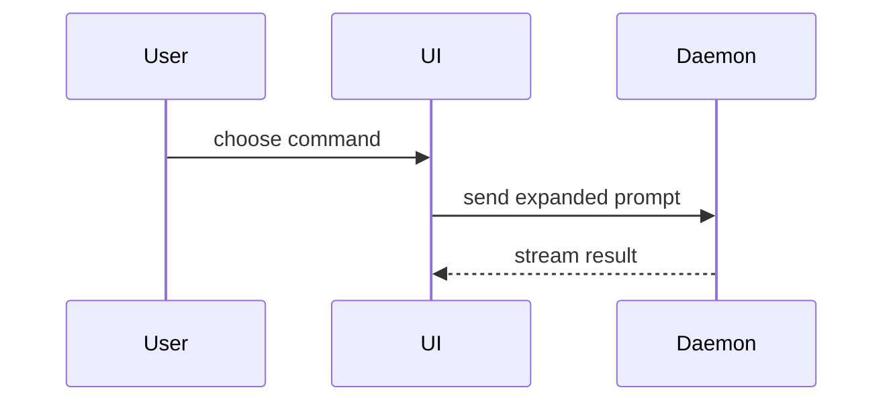

Use this template for the PR body:

```markdown
## Summary

<diagram, diff-sketch, or tree>

## Evidence

- **Before:** <screenshot, output, or failing test run>
  **After:** <screenshot, output, or passing test run>

## Merge Danger

**Door:** <one-way or two-way>

<optional: description>

**Blast Radius:** <one-word description>

<optional: potential ramifications of merge>
```

## Sections

Skip preambles. Keep prose brief. Use the user's domain language from `GLOSSARY.md`.

Attribution for the visual menu lives in [CREDITS.md](CREDITS.md). Use the menu. Leave the attribution file as the record of where it came from.

### Summary

Pick the smallest view that makes the key point clear.

- Show logic or an algorithm as pseudocode:

```text
on(save)
  if content is unchanged
    return cached result
  write new content
  return fresh result
```

- Show runtime control flow as a call tree:

```text
submitForm
  createSession
    persistPrompt
    launchAgent
  navigateToSession
```

- Show UI structure as a module tree, including state and module seams that matter:

```text
SessionPage (apps/example/src/routes/session.tsx)
  useSessionEvents()
  SessionToolbar
    RunSkillButton (packages/ui)
```

- Show file responsibility or a broad refactor as a shallow file tree:

```text
src/
├── commands/       # parses user actions
├── sessions/       # owns session state
└── transport/      # sends requests
```

- Show interaction, control flow, or data flow with Mermaid:



- Use `diff` when the point is what changes and the surrounding shape already exists. Match the diff shape to the topic.

For a module change:

```diff
 SessionPage
   useSessionEvents()
   SessionToolbar
+    RunSkillButton
   SessionTimeline
+    SkillResultCard
```

For a file-layout change:

```diff
 src/
 ├── commands/
+│   └── show-me.ts       # expands the slash command
 ├── sessions/
-└── transport.ts
+└── transport/
+    ├── client.ts
+    └── stream.ts
```

For a call-tree change:

```diff
 submitForm
   createSession
     persistPrompt
+    expandSkillMention
     launchAgent
-  navigateToSession
+  navigateToSession
+    subscribeToEvents
```

For a state or control-flow change:

```diff
 on(save)
-  write content
+  if content is unchanged
+    return cached result
+  write new content
+  invalidate cache
```

- Show the whole block when most of it is new, when omitted context would hide ownership or order, or when the user needs a copyable target shape:

```ts
function expandSkill(command: string): string {
  const skillName = command.slice(1);
  return `use the ${skillName} skill`;
}
```

#### Guidance

Place each visual next to the short text it supports. Keep only the calls, files, props, states, and seams needed to answer the current question.

Use one of these, or several. Using all of them is unlikely. Pick the smallest set that makes the change clear.

**Done when:** Summary contains the smallest visual that makes the change clear, and no visual is included that does not earn its place.

### Evidence

Concrete evidence that the change works. Show a before and an after.

Screenshots are the strongest evidence when the environment can capture them and the change is visual.

Execution evidence is the next strongest. Test results, console output. Show the exact test that now fails and passes, using pseudocode.

**Done when:** Evidence has a before and an after, each tied to something that was run or captured.

### Merge Danger

Say whether it is a one-way or a two-way door. You can walk back through a two-way door. You cannot walk back through a one-way door. A PR that is cheap to roll back is lower risk. Destructive actions and hard-to-reverse decisions are one-way doors.

The blast radius is the potential impact of the change. Consider the possibilities: layout shift, breakage for consumers, a narrow viewport, and the rest. Name it in one word, then the ramifications if they are not obvious.

**Done when:** Door is one-way or two-way, Blast Radius is one word, and both are grounded in the diff rather than a default.
